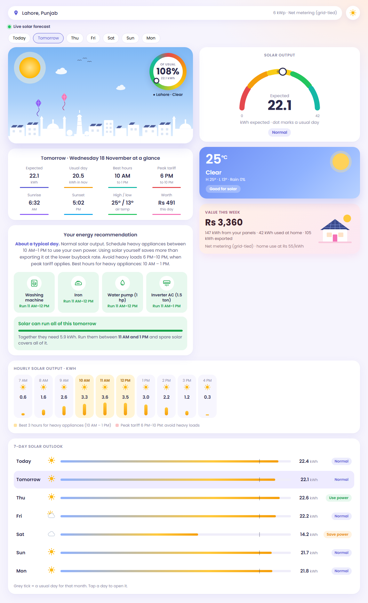
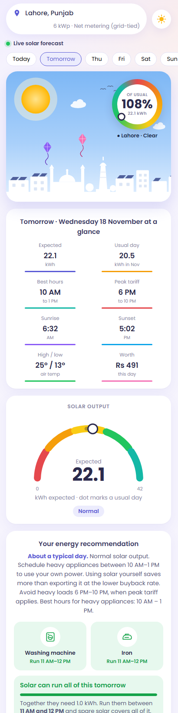
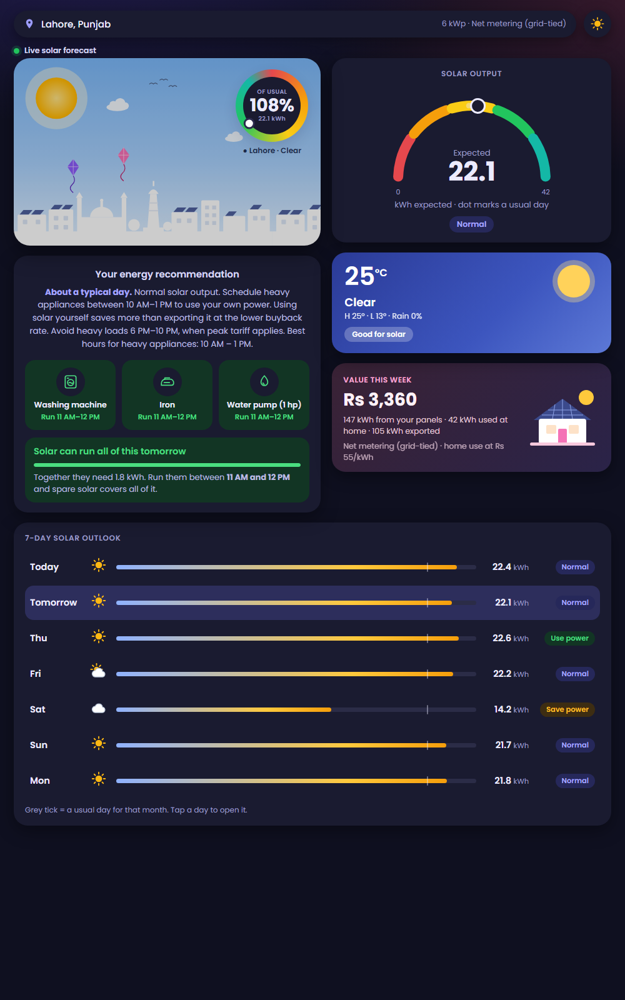

<div align="center">


### Know when the sun will power your home, and when to save electricity.

A rooftop-solar forecast for **30 cities across Pakistan**: a 7-day outlook in kWh, the best hours to run heavy appliances, and a long-term yield estimate built on NASA satellite data and transparent solar physics.


[](https://github.com/Tmfkces/SolarCast---PV-Yield-Forecaster/actions/workflows/ci.yml)


</div>

---

<p align="center">
  
</p>

## Why

Pakistan's households are adding rooftop solar quickly because electricity is expensive and supply is unreliable. But a solar system only saves money when you **use** its power: run the washing machine at noon instead of 8 PM, top up the battery before load-shedding, and stay off the grid during peak-tariff hours.

SolarCast turns the weather forecast into that kind of plain advice for **your** system:

> **Tomorrow: 22.1 kWh expected, 108% of a usual November day.**
> Schedule heavy appliances between 10 AM and 1 PM. Avoid heavy loads 6–10 PM, when peak tariff applies.

## Features

**Everyday outlook**
- **7-day forecast in kWh** for your system size, tilt and direction, laid out like a modern weather app:
  - an illustrated sky that changes with the weather and time of day (sunny, cloudy, rainy, sunset, night), over a Pakistani skyline with rooftop solar and Basant kites;
  - a colour ring showing the day as a percentage of a usual day, plus a half-circle gauge of the expected kWh;
  - an "at a glance" card, a weather card, an hourly strip, and a 7-day list;
  - quick city chips (Lahore, Karachi, Islamabad and more) to switch city in one tap.
- **Light and dark mode.** Follows your phone or computer setting automatically; or switch instantly from the ⋮ menu at the top right (System, Light or Dark).
- **Compared with a usual day.** Each day is rated against the median day for that month, so "Save power" and "Use power" only appear when a day really stands out.
- **Best hours for heavy appliances**, highlighted in the hourly strip.
- **Your energy recommendation.** Pick a washing machine, iron, water pump, geyser, AC, kettle or e-bike charger. Each gets a tile saying when to run it on solar (for example "Run 11 AM–12 PM") or to wait for a sunnier day, plus a check on whether solar covers them all together.
- **Pakistan-aware advice:**
  - seasonal **peak-tariff hours** (for example 6–10 PM in winter months);
  - setups for **net metering**, **battery or hybrid inverter**, and **on-grid without net metering**;
  - an honest **Rs value**: home use is counted at your bill rate and exports at the buyback rate.
- **Day-to-day details:**
  - opens on **Today** in the morning and **Tomorrow** in the evening;
  - shows "kWh still to come today" and marks the current hour as **Now**;
  - tap any day in the list to open it;
  - **remembers your settings**, and the page link can be bookmarked or shared;
  - keeps working **offline** with the last saved forecast.

**Analysis (for students and installers)**
- **Long-term estimate** from NASA POWER history (1981 to now): annual yield, specific yield (kWh/kWp), capacity factor, and a typical-year monthly profile.
- **Model check:** a day-ahead LightGBM forecast scored against persistence ("tomorrow = today") and climatology on an untouched test window.
- **Explain:** which weather inputs drive the forecast, and how its error changes by month.
- **Data:** the cleaned daily weather, downloadable as CSV.

<p align="center">
  
  &nbsp;&nbsp;
  
</p>

## Quick start

You need **Python 3.10 or newer**.

**Windows (PowerShell)**

```powershell
git clone https://github.com/Tmfkces/SolarCast---PV-Yield-Forecaster.git
cd SolarCast---PV-Yield-Forecaster\pv-yield-pk
python -m venv .venv
.venv\Scripts\python -m pip install -e ".[dev]"
.venv\Scripts\python -m streamlit run app.py
```

**macOS / Linux**

```bash
git clone https://github.com/Tmfkces/SolarCast---PV-Yield-Forecaster.git
cd SolarCast---PV-Yield-Forecaster/pv-yield-pk
python3 -m venv .venv
.venv/bin/pip install -e ".[dev]"
.venv/bin/streamlit run app.py
```

The app opens at <http://localhost:8501>. Pick your city, system size and setup in the sidebar. Everything else has sensible defaults, and your choices are remembered next time.

> No API keys are needed. Weather comes from free public services, and responses are cached in `pv-yield-pk/data/cache/` so repeat visits are instant.

## How it works

```
NASA POWER (daily history) ──┐                 ┌── Long-term estimate, model check
                             ├─► physics model ┤
Open-Meteo (7-day forecast) ─┘   kWh per day   └── 7-day outlook, best hours, advice
Open-Meteo archive (past forecasts) ──► "usual day" per month (median)
```

**1. Weather data**
- **Forecast:** Open-Meteo, 7 days of daily and hourly solar radiation and temperature.
- **History:** NASA POWER daily data back to 1981.
- **"Usual day":** calculated from Open-Meteo's archive of *past forecasts*, so the comparison uses the same models as the forecast. Mixing the two sources was off by up to ~40% in some months (Skardu in winter).

**2. Solar physics** (textbook method from Duffie & Beckman)
- Split daily sunlight into direct and diffuse parts using the clearness index and the Erbs correlation.
- Convert it onto your tilted panels with the Liu–Jordan isotropic-sky model. Any compass direction works because the direct-sunlight factor is integrated through the day.
- Reduce output for hot panels (NOCT model, −0.4% per °C).
- Apply a performance ratio for inverter and wiring losses, plus a dust (soiling) allowance.

**3. Advice**
- Each forecast day is compared with the usual day for its month:

  | Forecast vs usual | Label |
  | --- | --- |
  | ≥ 110% | **Use power** |
  | 85–110% | **Normal** |
  | 60–85% | **Save power** |
  | below 60% | **Save power** (very low) |

- The best 3-hour block comes from the hourly forecast.
- Peak-tariff hours and setup-specific tips (battery, net metering) are added on top.

**4. Machine learning** (Analysis tab)
- Predicts tomorrow's yield from today's weather history: lags, 7-day mean and clear-sky index.
- Uses a strict time split (70% train, 15% validation, 15% test); the number of trees is chosen on the validation window.
- Over 2019–2024 it beats "tomorrow = today" by 9–13% (RMSE) in all four benchmark cities. Full results are in [`pv-yield-pk/README.md`](pv-yield-pk/README.md#results).

## Command line

```bash
cd pv-yield-pk
python -m pvyield yield --city Lahore --start 2023-01-01 --end 2023-12-31 --kw 5
python -m pvyield benchmark --out docs/benchmark_metrics.csv --figures docs/figures
python -m pvyield train --city Karachi --start 2019-01-01 --end 2024-12-31 --out data/models/Karachi.joblib
```

## Tests

```bash
cd pv-yield-pk
pytest             # 105 offline tests (mocked weather APIs)
pytest -m network  # live checks against NASA POWER and Open-Meteo
ruff check .
```

The tests cover:
- solar geometry against textbook worked examples;
- the energy model;
- data cleaning and caching;
- leakage across data gaps;
- metrics;
- the forecast, advice and value logic;
- saved settings;
- a full run of the Streamlit app.

GitHub Actions runs lint and tests on Windows and Linux for every push ([`.github/workflows/ci.yml`](.github/workflows/ci.yml)).

## Project structure

```
.
├── README.md                     ← you are here
├── .github/workflows/ci.yml      lint + tests on push
└── pv-yield-pk/
    ├── app.py                    Streamlit app (Outlook + Analysis)
    ├── assets/                   SolarCast logo
    ├── src/pvyield/
    │   ├── cities.py             30 Pakistani cities
    │   ├── data.py               NASA POWER client, cleaning, cache
    │   ├── physics.py            sun geometry, transposition, temperature, energy
    │   ├── forecast.py           7-day outlook, usual day, advice, value, appliance planner
    │   ├── ui.py                 outlook cards, icons, sun arc
    │   ├── ml.py                 features, time split, LightGBM training
    │   ├── evaluate.py           metrics and baselines
    │   ├── plots.py              charts
    │   └── cli.py                python -m pvyield …
    ├── tests/                    pytest suite
    ├── notebooks/analysis.ipynb  reproducible analysis
    └── docs/                     benchmark, figures, screenshots, interview guide
```

The `artifacts/`, `lib/` and `scripts/` folders are a TypeScript template left over from Replit. The app doesn't use them.

## Limitations

- **Estimates, not guarantees.** SolarCast models your system from weather data. It does not read your inverter, so shading, dirty panels or faults are not seen.
- Forecast skill drops after 2–3 days, as with any weather app.
- The ML model learns from the physics model, because no metered rooftop data was available for training.
- Peak-tariff hours are typical DISCO hours. Check your own bill.
- Winter smog over Punjab can make real output lower than forecast.

## Roadmap

- [ ] Morning alerts on WhatsApp or SMS ("Tomorrow is cloudy, do laundry today")
- [ ] Calibrate to your real output by entering yesterday's inverter reading
- [ ] Urdu interface
- [ ] Hosted version (Streamlit Community Cloud)
- [ ] Load-shedding schedule input for battery planning

## Credits

- Weather data: [NASA POWER](https://power.larc.nasa.gov/) and [Open-Meteo](https://open-meteo.com/) (CC BY 4.0).
- Solar method: J. A. Duffie & W. A. Beckman, *Solar Engineering of Thermal Processes*; D. G. Erbs et al. (1982); B. Y. H. Liu & R. C. Jordan (1960).

## Author

**Tahreem Fatima**, BS Physics, Government College University Faisalabad.

## License

No license has been chosen yet. Until a `LICENSE` file is added, all rights are reserved by the author.
