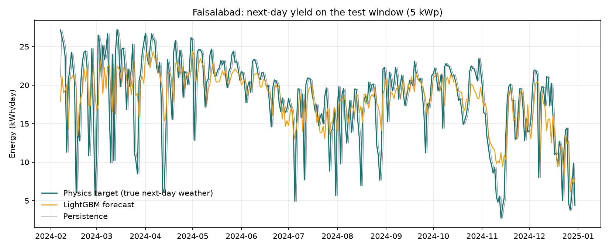
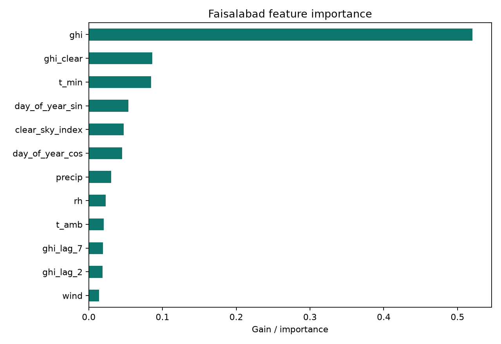

# SolarCast — PV Yield Forecaster for Pakistan


Daily rooftop-PV energy estimates for 30 cities across Pakistan, built on public NASA POWER weather, a transparent physics model, and a time-ordered day-ahead machine-learning forecast that is benchmarked against persistence and climatology.

> It is an analytical and teaching tool, not a bankable engineering guarantee.

## Problem

Rooftop solar is becoming an important way for Pakistani households and small businesses to manage high electricity costs and unreliable supply. A day-ahead estimate helps an owner plan consumption, understand seasonal production, and compare a proposed system size with expected demand.

## Data

Daily data comes from the NASA POWER *Renewable Energy* point endpoint (no API key):

| NASA parameter | Column | Meaning |
| --- | --- | --- |
| `ALLSKY_SFC_SW_DWN` | `ghi` | Global horizontal irradiation, kWh/m²/day |
| `CLRSKY_SFC_SW_DWN` | `ghi_clear` | Clear-sky GHI, kWh/m²/day |
| `T2M`, `T2M_MAX`, `T2M_MIN` | `t_amb`, `t_max`, `t_min` | Air temperature at 2 m, °C |
| `RH2M`, `WS2M`, `PRECTOTCORR` | `rh`, `wind`, `precip` | Humidity %, wind m/s, precipitation mm/day |

Cleaning (`pvyield.data.clean_daily_frame`):

- NASA's `-999` fill values **and missing calendar days** become gaps.
- Gaps of up to 3 days are forward-filled; longer gaps are removed.
- Requests are retried on 429/5xx and validated (dates from 1981-01-01, not in the future).
- Each `(city, start, end)` response is cached in `data/cache/` as CSV. Ranges ending in the last 10 days are *not* cached because NASA may still revise them.

## Method

### Physics model (`pvyield.physics`)

The model follows the classic daily chain from Duffie & Beckman, *Solar Engineering of Thermal Processes*.

1. **Extraterrestrial irradiation** on a horizontal plane, $H_0$, from latitude $\phi$, declination $\delta$ and sunset hour angle $\omega_s$:

$$
H_0 = \frac{24}{\pi} G_{sc}\left(1 + 0.033\cos\frac{360n}{365}\right)\left(\cos\phi\cos\delta\sin\omega_s + \omega_s\sin\phi\sin\delta\right)
$$

2. **Clearness index** $K_t = H / H_0$ and **diffuse fraction** $H_d/H$ from the Erbs et al. (1982) daily correlation. Beam is $H_b = H - H_d$.

3. **Plane-of-array irradiation** with the Liu–Jordan isotropic-sky model (tilt $\beta$, ground albedo $\rho = 0.2$):

$$
H_T = H_b R_b + H_d\frac{1+\cos\beta}{2} + H\rho\frac{1-\cos\beta}{2}
$$

   $R_b$ is the daily beam tilt factor. It is integrated numerically over the hour angle while the sun is above both the horizon and the panel plane, so **any azimuth** (east, south, west…) is supported. For south-facing panels the tests check it against Klein's closed form to within 1 %.

4. **Cell temperature** from the daytime-average POA irradiance $G_\text{avg} = 1000\,H_T/\text{daylight hours}$:

$$
T_\mathrm{cell} = T_\mathrm{amb} + \frac{\mathrm{NOCT}-20}{800}G_\mathrm{avg}, \qquad f_T = 1 + \gamma(T_\mathrm{cell}-25)
$$

5. **Daily AC energy**:

$$
E_\mathrm{kWh} = P_\mathrm{STC}\cdot H_T\cdot f_T\cdot \mathrm{PR}\cdot(1-s)
$$

Defaults: NOCT 45 °C, $\gamma = -0.4\,\%/°C$, performance ratio PR = 0.80 (inverter, wiring, mismatch — *not* temperature or soiling, which are modelled separately), soiling $s = 3\,\%$. Days with missing weather return `NaN`, never a misleading zero.

The earlier first-order transposition (noon beam ratio applied to the whole of GHI) is kept as `transposition="geometric"` for comparison. It over-credits tilt on cloudy days because it treats diffuse light as if it were beam.

### Machine-learning model (`pvyield.ml`)

- **Target:** the physics yield of the **next calendar day**, computed from that day's real weather. This is a proxy, because no metered plant output is available.
- **Features (day *t*):** GHI, clear-sky GHI, clear-sky index, temperatures, humidity, wind, precipitation, day-of-year sine/cosine, GHI lags of 1, 2, 3 and 7 days, and the 7-day rolling mean GHI.
- **Leakage control:** the data is re-indexed to a full daily calendar before any shift, so a removed gap can never pair a day with a target or lag from weeks away. A regression test guards this.
- **Split:** chronological, 70 % train / 15 % validation / 15 % test, with no shuffling.
- **Model selection:** the number of boosting rounds is chosen by validation RMSE (LightGBM early stopping, or `staged_predict` for the scikit-learn fallback). The model is then refit on train + validation, and the test window is scored once.
- **Estimator:** `LightGBM` when its native runtime loads, otherwise scikit-learn `GradientBoostingRegressor`.

### Evaluation (`pvyield.evaluate`)

On the untouched test window:

| Row | What it is |
| --- | --- |
| Persistence | Tomorrow = today's physics yield |
| Climatology (monthly mean) | Mean training-period target for tomorrow's calendar month |
| Physics oracle (true next-day weather) | Equals the target by construction. A sanity check, **not** a forecast |
| LightGBM / GradientBoosting | Day-ahead ML forecast |

Metrics: RMSE, MAE, MAPE (days ≥ 0.5 kWh), mean bias (predicted − actual), R², and RMSE skill vs persistence $1-\mathrm{RMSE}/\mathrm{RMSE}_\text{persistence}$.

## Results

Regenerate the table and figures (uses the cached NASA responses):

```bash
python -m pvyield benchmark --start 2019-01-01 --end 2024-12-31 --out docs/benchmark_metrics.csv --figures docs/figures
```

<!-- BENCHMARK:START -->
5 kWp system, latitude tilt facing south, PR 0.80, 3 % soiling, NASA POWER 2019-01-01 to 2024-12-31. Test window is the last 15 % of days (about Feb 2024 – Dec 2024); LightGBM rounds were chosen on the preceding 15 % validation window.

| City | Model | RMSE (kWh) | MAE (kWh) | MAPE (%) | Bias (kWh) | R² | Skill vs persistence |
| --- | --- | ---: | ---: | ---: | ---: | ---: | ---: |
| Faisalabad | Persistence | 4.404 | 2.957 | 22.11 | +0.051 | 0.292 | +0.000 |
| Faisalabad | Climatology (monthly mean) | 4.571 | 3.396 | 29.62 | +0.215 | 0.238 | -0.038 |
| Faisalabad | Physics oracle (true next-day weather) | 0.000 | 0.000 | 0.00 | +0.000 | 1.000 | +1.000 |
| Faisalabad | LightGBM | 3.842 | 2.771 | 22.46 | -0.028 | 0.461 | +0.127 |
| Karachi | Persistence | 3.200 | 2.004 | 12.00 | -0.019 | 0.432 | +0.000 |
| Karachi | Climatology (monthly mean) | 3.276 | 2.155 | 14.63 | +0.751 | 0.405 | -0.024 |
| Karachi | Physics oracle (true next-day weather) | 0.000 | 0.000 | 0.00 | +0.000 | 1.000 | +1.000 |
| Karachi | LightGBM | 2.819 | 1.790 | 11.94 | +0.386 | 0.559 | +0.119 |
| Quetta | Persistence | 4.675 | 2.761 | 14.82 | +0.059 | -0.000 | +0.000 |
| Quetta | Climatology (monthly mean) | 4.716 | 3.150 | 18.84 | +0.777 | -0.018 | -0.009 |
| Quetta | Physics oracle (true next-day weather) | 0.000 | 0.000 | 0.00 | +0.000 | 1.000 | +1.000 |
| Quetta | LightGBM | 4.127 | 2.616 | 15.91 | +0.499 | 0.221 | +0.117 |
| Skardu | Persistence | 6.767 | 4.939 | 30.60 | +0.019 | 0.156 | +0.000 |
| Skardu | Climatology (monthly mean) | 7.882 | 6.517 | 42.02 | -1.289 | -0.145 | -0.165 |
| Skardu | Physics oracle (true next-day weather) | 0.000 | 0.000 | 0.00 | +0.000 | 1.000 | +1.000 |
| Skardu | LightGBM | 6.169 | 4.979 | 32.65 | -0.270 | 0.299 | +0.088 |
<!-- BENCHMARK:END -->





**What the numbers say**

- LightGBM has the lowest RMSE in all four cities, 9–13 % better than persistence. Seasonal climatology is *worse* than persistence everywhere, so the ML gain comes from recent-weather information, not just from knowing the season.
- The gain is mostly on large errors. The forecast is smoother than reality and rarely predicts sudden cloudy days, so MAPE is about equal to or slightly worse than persistence in Faisalabad, Quetta and Skardu, and MAE is slightly worse in Skardu. The plot above shows this: the orange line tracks the level well but misses the deep one-day dips.
- Karachi and Quetta show a positive bias (+0.4–0.5 kWh/day), meaning the 2024 test year was darker than the training years.
- With a 1 kWp system, Faisalabad averages about **1,315 kWh/kWp per year** on this weather (2019–2024), which is in the expected range for Punjab with NASA POWER's aerosol-reduced irradiance.

Read the comparison as a forecast-proxy benchmark, not validation against a real PV meter.

## Limitations and next steps

- No metered plant data, so the ML target is a physics proxy. Validating against inverter logs from real Pakistani rooftops is the most valuable next step.
- Daily, isotropic-sky model: no hourly sun position, circumsolar/horizon brightening (Perez/HDKR), shading, or inverter clipping.
- PR is a single factor rather than a component-level loss model; dust events, cleaning schedules, and outages are not observed.
- The day-ahead model uses only today's weather history. Adding a numerical weather prediction (e.g. tomorrow's forecast cloud cover) would give a much stronger forecast.

## How to run

**Windows (PowerShell)**

```powershell
cd pv-yield-pk
python -m venv .venv
.venv\Scripts\python -m pip install -e ".[dev]"
.venv\Scripts\python -m pytest
.venv\Scripts\python -m streamlit run app.py
```

**macOS / Linux**

```bash
cd pv-yield-pk
python -m venv .venv
.venv/bin/pip install -e ".[dev]"
.venv/bin/pytest
.venv/bin/streamlit run app.py
```

`pip install -r requirements.txt` also works (then run with `PYTHONPATH=src`).

### Command line

```bash
python -m pvyield yield --city Lahore --start 2023-01-01 --end 2023-12-31 --kw 5 --tilt 30 --azimuth 180
python -m pvyield benchmark --cities Faisalabad Karachi --out docs/benchmark_metrics.csv
python -m pvyield train --city Karachi --start 2019-01-01 --end 2024-12-31 --out data/models/Karachi.joblib
```

### Tests

`pytest` runs 105 offline tests. They cover solar geometry against textbook values, the energy model, cleaning, caching with mocked NASA and Open-Meteo APIs, leakage across gaps, model selection, metrics, the 7-day outlook (usual day, advice, peak hours, value, appliance planner, offline copy), the CLI, saved settings, and end-to-end Streamlit runs. `pytest -m network` adds live NASA POWER and Open-Meteo requests.

### App

The Streamlit app has two tabs.

- **Outlook** (everyday use). A 7-day forecast from Open-Meteo, run through the same physics model.
  - Each day is compared with a *usual day*: the median for that month from Open-Meteo's archive of past forecasts, so both come from the same source.
  - Advice includes the best 3 hours for heavy appliances, seasonal peak-tariff hours, and tips for net-metering, battery and grid-only setups.
  - The weekly Rs value counts home use at your tariff and exports at the buyback rate.
  - An appliance planner checks whether solar can run what you pick.
  - Settings are saved to `data/user_settings.json` and to the page link. The last forecast is kept for offline use.
- **Analysis.** Long-term estimate, model check, explanation and data for a NASA POWER period you choose. The ML comparison uses the same physics settings as the outlook.

Code: `src/pvyield/forecast.py` (outlook logic) and `src/pvyield/ui.py` (cards, icons, sun arc).

## Project layout

```
pv-yield-pk/
├── app.py                  Streamlit UI (Outlook + Analysis)
├── assets/                 SolarCast logo
├── src/pvyield/
│   ├── cities.py           30 reference locations
│   ├── data.py             NASA POWER client, cleaning, cache
│   ├── physics.py          Erbs + Liu–Jordan transposition, temperature, energy
│   ├── ml.py               features, time split, training, save/load
│   ├── evaluate.py         metrics, baselines, benchmark
│   ├── forecast.py         Open-Meteo outlook, usual day, advice, value, appliance planner
│   ├── ui.py               outlook HTML/CSS, weather icons, sun arc
│   ├── plots.py            Plotly figures
│   └── cli.py              `python -m pvyield …`
├── tests/                  pytest suite (offline by default)
├── notebooks/analysis.ipynb
└── docs/                   benchmark CSV, figures, screenshots, interview guide
```

## Author

Tahreem Fatima, BS Physics (GCUF)
