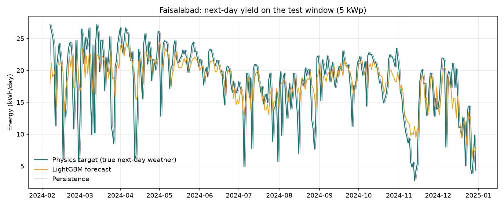
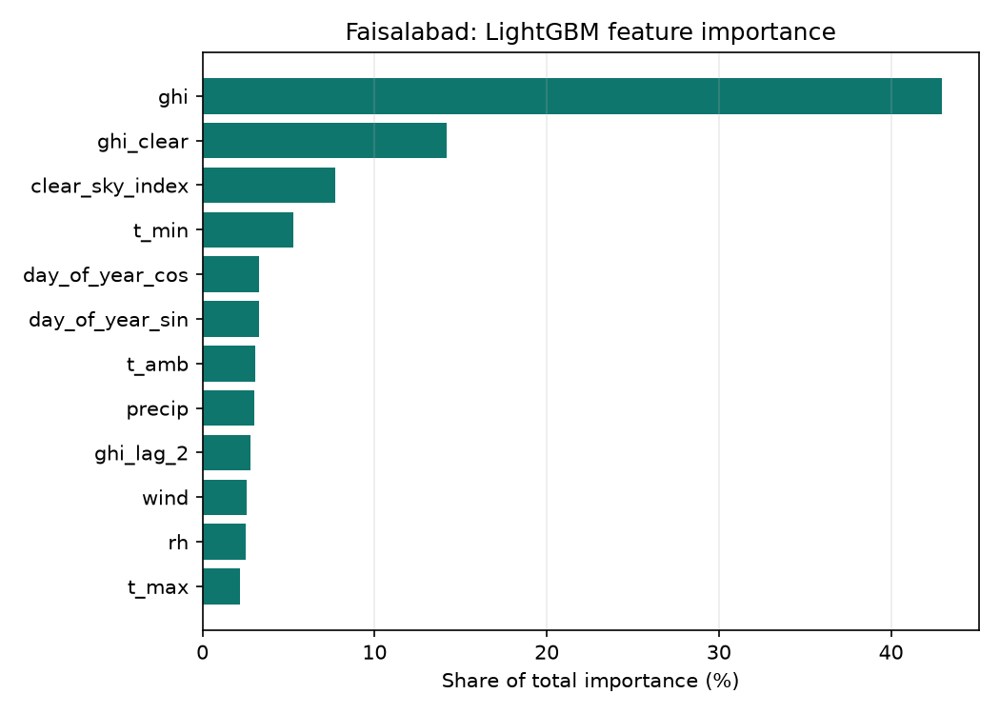

# PV Yield Forecaster: A Beginner's Guide for Research Interviews

## How to use this guide

This guide explains the project in everyday language, then gives you a short way to describe it in an interview. You do not need to memorize every equation. First understand the overall flow, the difference between the physics model and the machine-learning model, and the project's most important limitation.

**Important:** This project does not have measurements from a real solar installation. Its machine-learning labels are generated by the physics model. Say “physics-model target” or “proxy target,” not “measured solar production.” If you used coding assistance or worked with collaborators, describe your own contribution accurately.

## 1. The project in one sentence

The PV Yield Forecaster estimates how much electricity a rooftop solar system could produce each day in a selected Pakistani city, using public weather data, a simple physics model, and a machine-learning forecast for the next day.

“PV” means **photovoltaic**: technology that turns sunlight into electricity. “Yield” means the amount of electrical energy produced over a period of time.

## 2. The problem it addresses

Sunlight changes by season, cloud cover, temperature, and location. A household or small business considering rooftop solar wants a practical estimate of expected energy, not only the system's advertised maximum power.

This project provides two related views:

1. **Physics estimate:** Given the weather for a day, estimate the energy a solar system would produce that day.
2. **Day-ahead ML estimate:** Use weather information available up through today to estimate tomorrow's physics-based yield.

These are estimates for analysis and learning. They are not a guarantee, a utility bill forecast, or a bankable engineering study.

## 3. The central idea: weather goes in, energy estimate comes out

The complete flow is:

1. Choose a city, date range, system size, tilt, and losses.
2. Look for that city's date range in the local data cache.
3. If it is not cached, request daily weather values from the public NASA POWER API.
4. Turn NASA's response into a date-indexed table and clean missing values.
5. Use the physics model to estimate daily energy.
6. Build historical-weather features and train a model for next-day yield.
7. Compare the forecast with a simple persistence baseline on a later time period.
8. Show the outputs in Streamlit charts and tables.

```text
City + dates
    |
    v
NASA POWER daily weather ---> clean and cache the data
    |                               |
    +-------------------------------+
                    |
                    v
           Physics yield estimate
                    |
          +---------+----------+
          |                    |
          v                    v
       Forecast             Proxy target
                               |
Today's weather history ---> ML model ---> next-day estimate
                               |
                               v
                    Test-window comparison
```

## 4. Where the main parts live

| File | What it does |
| --- | --- |
| `src/pvyield/cities.py` | Stores coordinates, elevation, and province for 30 Pakistani cities. |
| `src/pvyield/data.py` | Requests NASA POWER data, cleans it, and caches it as CSV. |
| `src/pvyield/physics.py` | Calculates clear-sky index, solar geometry, cell temperature, and physics yield. |
| `src/pvyield/ml.py` | Creates time-aware features, builds the next-day proxy label, splits data by time, and trains a model. |
| `src/pvyield/evaluate.py` | Calculates forecast metrics and compares models. |
| `src/pvyield/plots.py` | Creates reusable Plotly figures. |
| `app.py` | Connects those scientific modules to the Streamlit interface. |
| `tests/` | Checks core physics, cleaning, and time-based training behavior. |
| `notebooks/analysis.ipynb` | Re-runs the city comparisons and displays example figures. |
| `docs/figures/` | Stores the example Faisalabad report figures. |

The scientific modules can be imported and used without opening the Streamlit app. That separation makes the calculations easier to test and reuse.

## 5. The weather data

### Source

The project uses the **NASA POWER** public daily point-data API. It is a remote data service: the program sends a location and date range and receives a JSON response. No API key is required for this endpoint.

The project requests these weather values:

| NASA value | Project column | Simple meaning |
| --- | --- | --- |
| `ALLSKY_SFC_SW_DWN` | `ghi` | Daily sunlight energy on a flat, horizontal surface with actual sky conditions. |
| `CLRSKY_SFC_SW_DWN` | `ghi_clear` | Estimated daily sunlight energy under clear-sky conditions. |
| `T2M` | `t_amb` | Average air temperature at 2 metres. |
| `T2M_MAX` | `t_max` | Daily maximum air temperature. |
| `T2M_MIN` | `t_min` | Daily minimum air temperature. |
| `RH2M` | `rh` | Relative humidity near 2 metres. |
| `WS2M` | `wind` | Wind speed near 2 metres. |
| `PRECTOTCORR` | `precip` | Corrected precipitation estimate. |

NASA's solar radiation values are daily energy per unit area, usually expressed as **kWh/m²/day**. Temperature is in degrees Celsius; humidity is a percentage. The weather data is not electricity generated by a solar panel.

### Cleaning and caching

NASA uses `-999` as a marker for unavailable values. The program changes these markers to missing values. It forward-fills a missing value for up to three consecutive days, using the previous available value. Longer runs of missing data are removed. A row still has to have all expected weather columns to be retained.

The cleaned table is saved in `data/cache/` with a name based on the city and requested dates. Re-running the same request can use the saved file instead of making another network request. If you need a fresh NASA response, remove that exact cache file first.

### Why use an external weather source?

Historical weather provides a repeatable way to study locations and compare seasons. It is a reasonable starting point when on-site sensors are not available. It is not the same as measuring conditions directly on a particular roof: local shade, dust, building geometry, and microclimate can differ.

## 6. The physics model, explained simply

The physics model turns daily sunlight and temperature into an energy estimate. Its main steps are solar angle, panel-facing sunlight, panel temperature, and system losses.

### Step 1: estimate the Sun's seasonal position

The Sun appears higher or lower in the sky across the year. The program uses the date's **day of year** and a standard approximate solar declination equation to represent this seasonal change.

You do not need to derive the equation in an interview. The key point is: the Sun's angle depends on both the location's latitude and the day of year.

### Step 2: adjust horizontal sunlight to the panel plane

NASA's GHI is measured for a horizontal surface. A tilted solar panel receives sunlight at a different angle. Direct sunlight (beam) and scattered sky light (diffuse) behave differently, so the model splits them first:

```text
H0  = sunlight at the top of the atmosphere for this latitude and date
Kt  = GHI / H0                       (clearness index: 0 = very cloudy, ~0.75 = very clear)
Hd  = GHI × diffuse_fraction(Kt)     (Erbs et al. 1982 correlation)
Hb  = GHI − Hd                       (beam part)

POA = Hb × Rb  +  Hd × (1 + cos tilt) / 2  +  GHI × albedo × (1 − cos tilt) / 2
```

- **GHI** is global horizontal irradiance, or daily solar energy on a flat surface.
- **POA** means plane-of-array irradiance: an estimate of the daily solar energy reaching the panel's tilted plane.
- **Rb** is how much more (or less) beam sunlight the tilted panel catches than a flat surface over the whole day. The code computes it by stepping the Sun across the sky in half-degree steps, so it works for any panel direction (azimuth): south, east, west, or anything in between.
- The diffuse term assumes sky light comes evenly from the whole sky (the Liu–Jordan "isotropic" model). The last term is light reflected from the ground (albedo 0.2).
- The default panel tilt is the city's latitude, facing south.

Why this matters: on a cloudy day most light is diffuse, so tilting the panel gains very little. The first version of this project applied the beam ratio to *all* of GHI and therefore over-credited tilt on cloudy days. That older formula is still available as `transposition="geometric"` for comparison.

The tests check the numerical Rb against Klein's textbook closed-form formula (within 1 %) and the top-of-atmosphere value against a worked example in Duffie & Beckman. The model still works on daily totals: it does not represent shading, horizon brightening, or hour-by-hour weather.

### Step 3: estimate panel-cell temperature

Panels become warmer than the surrounding air when sunlight hits them. The model estimates daytime-average sunlight by dividing daily POA energy by daylight hours and converting to watts per square metre. It then applies:

```text
Cell temperature = air temperature
                 + (NOCT - 20) / 800 × daytime-average sunlight
```

**NOCT** means nominal operating cell temperature. The default is 45 °C. This is a simplified relationship, not a detailed thermal simulation.

### Step 4: reduce efficiency for heat

Solar modules generally produce less power when their cells are hotter than the 25 °C reference condition. The model uses:

```text
Temperature factor = 1 + gamma × (cell temperature - 25)
```

The default `gamma` is `-0.004 per °C`. The negative sign represents lower efficiency at higher cell temperature. For example, if the cells are warmer, the temperature factor gets smaller.

### Step 5: account for system losses and estimate daily energy

The model combines system size, sunlight, temperature, and losses:

```text
Daily energy (kWh) = system size (kW)
                   × POA (kWh/m²/day)
                   × temperature factor
                   × performance ratio
                   × (1 - soiling loss)
```

- **System size** is the system's rated DC capacity at standard test conditions, in kW.
- The default **performance ratio** is 0.80. It is a simplified combined allowance for inverter, wiring, mismatch, and other system losses.
- The default extra **soiling loss** is 0.03, or 3%, to represent a modest dust allowance.

The formula assumes that the conversion from sunlight exposure to rated system energy is represented by the chosen system size and performance-ratio factors. It is a deliberately compact teaching model; it is not a full module-by-module electrical simulation.

### Clear-sky index

The clear-sky index is:

```text
clear-sky index = GHI / clear-sky GHI
```

It is clipped between 0 and 1.2. A low value often indicates that clouds or other atmospheric conditions reduced sunlight compared with the clear-sky estimate. It is a useful weather feature, but it is not a direct cloud measurement.

## 7. The machine-learning model

### What is the ML model trying to predict?

The aim is to estimate **tomorrow's physics-model energy using weather history available through today**.

The project does not have real inverter or meter measurements. Therefore, it creates a **proxy target** by running the physics model on tomorrow's actual NASA weather. “Actual” in the metric table means the target value for the evaluation calculation; it does not mean actual measured solar electricity.

### Features: the clues given to the model

The model uses 16 input features:

1. Today's `ghi`
2. Today's `ghi_clear`
3. Today's clear-sky index
4. Today's average air temperature
5. Today's maximum temperature
6. Today's minimum temperature
7. Today's relative humidity
8. Today's wind speed
9. Today's precipitation
10. Seasonal day-of-year sine value
11. Seasonal day-of-year cosine value
12–15. GHI from 1, 2, 3, and 7 days earlier
16. The 7-day rolling mean of GHI

The sine and cosine values encode the time of year in a way that wraps smoothly from December back to January. For example, day 365 is close to day 1 in the annual cycle.

**Lagged values** are earlier observations. A lag of 1 means the previous day's GHI. A rolling mean smooths recent daily changes. These features let the model use recent weather patterns rather than only one day's readings.

### How the next-day target is aligned

The features on date `t` are paired with the physics estimate for date `t + 1`. This one-day shift is what makes the ML task day-ahead. The rows at the start of the dataset that cannot have a complete 7-day history are dropped; the final row has no next-day target inside the data range and is dropped too.

The shift is by **calendar day**, not by table row. Cleaning removes long gaps (more than 3 missing days), so the code first rebuilds a complete daily calendar and only then shifts. Without this, the day just before a two-week gap would be paired with a "tomorrow" that is really two weeks later. An automated test checks that every target is exactly one day after its features, even when a gap is present.

### Which algorithm runs?

The intended main model is **LightGBM**, a tree-based machine-learning method. Tree models learn patterns by making a series of decisions such as “if irradiance is in this range and temperature is above that range, predict this yield.”

The current benchmark ran with LightGBM. On some machines (for example the original Replit environment) LightGBM cannot load its native runtime library; the code then automatically uses the **scikit-learn GradientBoostingRegressor fallback**, and the table row is labelled `GradientBoosting`.

The fallback is also a tree-based boosting model. Boosting builds a sequence of small trees, with each later tree helping correct errors left by earlier trees.

### Time split: training on the past

The records remain in date order and are not shuffled:

```text
Oldest records                                      Newest records
|------- 70% training -------|-- 15% validation --|-- 15% test --|
```

- The **training** portion is used to fit candidate models.
- The **validation** portion chooses how many boosting rounds (trees) to use: training stops when the validation error stops improving ("early stopping").
- The model is then refit on training + validation with that number of rounds.
- The **test** portion is the latest period. It is used exactly once, for the reported comparison.

This means the number of trees *was* tuned on the validation set, and the test set was never used for any decision.

Keeping time order is important because a model forecasting future days should not learn from future observations before being tested on the past. Shuffling could create an unrealistically easy result by mixing earlier and later weather across the training and testing sets.

### Persistence baseline

A basic forecast is useful for comparison. **Persistence** assumes tomorrow will be like today: it predicts tomorrow's yield using today's physics-model yield. This is not sophisticated, but if an ML system cannot improve on a simple baseline, the ML model may not add value.

## 8. How the models are compared

All reported comparisons use the test time window. The output contains four rows:

1. **Persistence:** tomorrow is predicted from today's estimated yield.
2. **Climatology (monthly mean):** tomorrow is predicted as the average training-period yield for tomorrow's calendar month. This "seasonal average" baseline ignores today's weather entirely.
3. **Physics oracle (true next-day weather):** the physics model is given true tomorrow's weather, and the resulting yield is compared with the same physics-generated target.
4. **LightGBM or GradientBoosting:** the model estimates tomorrow's target using today's weather history.

A useful ML forecast should beat *both* persistence and climatology. The table also reports **bias** (average of predicted − actual): positive means the model over-forecasts on average.

The oracle row has zero error by construction: the target itself is defined as the physics model's output on tomorrow's true weather. This row is an **oracle reference** showing what would happen if tomorrow's weather were already known. It is not an independent model, a real upper bound on all possible physical systems, or a deployable forecast.

The scores are:

| Score | Plain-language interpretation |
| --- | --- |
| RMSE | Typical error size, with larger mistakes penalized more heavily. Lower is better. |
| MAE | Average absolute error. Lower is better. |
| MAPE | Average percentage error on target days at or above 0.5 kWh. Lower is better. |
| R² | How much better the predictions are than simply using the mean target, under the R² definition. 1 is perfect; 0 is mean-level performance; a negative score is possible. |
| Skill vs persistence | `1 - model RMSE / persistence RMSE`. Positive means better RMSE than persistence; 0 means equal; negative means worse. |

All error scores are based on **daily energy** and should be read in kWh/day (or percentages for MAPE), even though table headings are shortened in the app.

## 9. What the recorded results say

The benchmark used a 5 kW system facing south at latitude tilt, and NASA POWER data from 2019-01-01 through 2024-12-31. The test window is roughly February to December 2024. The model was LightGBM; the number of trees was chosen on the validation window just before it. Errors are daily energy in kWh/day. Reproduce with `python -m pvyield benchmark --out docs/benchmark_metrics.csv --figures docs/figures`.

| City | Model | RMSE | MAE | MAPE | Bias | R² | Skill vs persistence |
| --- | --- | ---: | ---: | ---: | ---: | ---: | ---: |
| Faisalabad | Persistence | 4.404 | 2.957 | 22.11% | +0.051 | 0.292 | +0.000 |
| Faisalabad | Climatology (monthly mean) | 4.571 | 3.396 | 29.62% | +0.215 | 0.238 | -0.038 |
| Faisalabad | Physics oracle (true next-day weather) | 0.000 | 0.000 | 0.00% | +0.000 | 1.000 | +1.000 |
| Faisalabad | LightGBM | 3.842 | 2.771 | 22.46% | -0.028 | 0.461 | +0.127 |
| Karachi | Persistence | 3.200 | 2.004 | 12.00% | -0.019 | 0.432 | +0.000 |
| Karachi | Climatology (monthly mean) | 3.276 | 2.155 | 14.63% | +0.751 | 0.405 | -0.024 |
| Karachi | Physics oracle (true next-day weather) | 0.000 | 0.000 | 0.00% | +0.000 | 1.000 | +1.000 |
| Karachi | LightGBM | 2.819 | 1.790 | 11.94% | +0.386 | 0.559 | +0.119 |
| Quetta | Persistence | 4.675 | 2.761 | 14.82% | +0.059 | -0.000 | +0.000 |
| Quetta | Climatology (monthly mean) | 4.716 | 3.150 | 18.84% | +0.777 | -0.018 | -0.009 |
| Quetta | Physics oracle (true next-day weather) | 0.000 | 0.000 | 0.00% | +0.000 | 1.000 | +1.000 |
| Quetta | LightGBM | 4.127 | 2.616 | 15.91% | +0.499 | 0.221 | +0.117 |
| Skardu | Persistence | 6.767 | 4.939 | 30.60% | +0.019 | 0.156 | +0.000 |
| Skardu | Climatology (monthly mean) | 7.882 | 6.517 | 42.02% | -1.289 | -0.145 | -0.165 |
| Skardu | Physics oracle (true next-day weather) | 0.000 | 0.000 | 0.00% | +0.000 | 1.000 | +1.000 |
| Skardu | LightGBM | 6.169 | 4.979 | 32.65% | -0.270 | 0.299 | +0.088 |





LightGBM had the lowest RMSE in all four cities, about 9–13 % better than persistence. The monthly-average (climatology) baseline was worse than persistence everywhere, so the improvement comes from using recent weather, not just from knowing the season. It does **not** prove the model will beat persistence on measured rooftop production or future years.

The improvement is mostly on large errors. The ML forecast is smoother than reality and rarely predicts a sudden cloudy day, so its MAPE is about the same as, or slightly worse than, persistence in Faisalabad, Quetta and Skardu, and its MAE is slightly worse in Skardu. Skardu has the largest errors overall, which fits its more variable mountain weather, but proving the cause would need more research (seasonal error analysis, more years and locations).

Feature importance ranks which inputs the fitted tree model used most. It is useful for describing patterns in this dataset, but it does not prove that a feature causes higher or lower yield. Correlated features can share or distort importance.

## 10. What the user interface does

The Streamlit app lets a user:

- Select one of 30 cities; Faisalabad is selected by default.
- Choose system size, tilt, azimuth (panel direction), performance ratio, soiling loss, and date range.
- Run the analysis.
- View headline annualized yield, yield per kWp, capacity factor, and best/worst month, plus a typical-year monthly profile.
- Compare physics-target predictions with persistence, climatology and ML on the test window. The ML comparison uses the same tilt, azimuth and loss settings as the forecast.
- View actual-versus-predicted, scatter, feature-importance and monthly-residual charts.
- Inspect and download the cleaned weather table as a CSV.

The model is trained once per settings combination, and training never writes files to disk. Weather retrieval and model training use Streamlit's cache. This avoids repeating expensive fetches or training while settings remain the same. The first calculation can take longer than later views, especially when data has not been cached yet.

## 11. Tests and what they prove

The automated suite (`pytest`, runs offline) is grouped like this:

- **Solar geometry against textbook values:** top-of-atmosphere sunlight matches a worked example in Duffie & Beckman; the numerical beam factor Rb matches Klein's closed-form formula within 1 % for several dates and tilts; a flat panel's POA equals GHI; east- and west-facing panels are symmetric; south beats north in winter; tilt helps much less on overcast days.
- **Energy model:** zero sunlight gives zero energy; missing weather gives "missing", not zero; hotter air lowers output; output scales with system size and losses; a realistic Faisalabad year gives a typical specific yield (1,300–1,800 kWh/kWp); invalid inputs are rejected.
- **Data:** fill values and short gaps are handled, long gaps and missing calendar days are removed, the NASA response is parsed, dates are validated, and caching works (tested with a fake NASA server so no internet is needed).
- **Machine learning:** the split is chronological, every target is exactly the next calendar day even across gaps, validation picks the number of trees, training writes no files, the model beats persistence on learnable data, and saved models reload correctly.
- **Evaluation, CLI and app:** metrics match hand calculations; the benchmark command writes the CSV and figures; the Streamlit app runs end to end.

These are focused software and behavior checks. They do not validate the model against a real solar installation. A live API fetch was separately run for Faisalabad 2023, and the interface endpoint was checked for startup; those are operational checks, not scientific ground-truth validation.

## 12. Main limitations and research improvements

### What this version does not know

- It has no actual inverter or smart-meter PV production measurements.
- It uses daily weather values, not hourly irradiance or hourly production.
- Its direct/diffuse split comes from a daily correlation (Erbs), not measured beam and diffuse data, and the sky is treated as uniformly bright (isotropic).
- It has no shading, horizon, or panel-level design model.
- It uses general loss assumptions instead of a detailed plant model.
- It does not observe dust events, cleaning dates, equipment outages, or curtailment.
- Its ML target inherits any errors in the physics model.
- The day-ahead model only sees today's weather history, not a weather forecast for tomorrow.

### Strong next steps for research

1. Obtain time-aligned real PV output, system rating, panel layout, tilt, azimuth, inverter, and cleaning records.
2. Compare NASA weather with local station or rooftop measurements when possible.
3. Add tomorrow's numerical weather forecast (e.g. predicted cloud cover) as a feature.
4. Compare multiple models and report uncertainty, not only one point estimate.
5. Move to hourly calculations with an anisotropic sky model (HDKR or Perez).
6. Test generalization across years, cities, and system sizes.
7. Report the data source version and cache used so results can be reproduced.

## 13. A short interview explanation

Adapt this answer to match what you personally worked on:

> “My project is a daily photovoltaic yield forecasting tool for Pakistani cities. It retrieves historical daily weather from NASA POWER, cleans missing values, and applies a transparent physics-based model that adjusts sunlight for panel tilt, estimates cell-temperature losses, and applies system-loss assumptions. I also built a day-ahead machine-learning comparison using weather history and a chronological train/validation/test split. Because I did not have measured output from a real PV plant, the ML target is the physics model's output using the next day's actual weather, so I describe the results as a proxy benchmark rather than real production validation. The project includes a Streamlit interface, reusable Python modules, tests, and a notebook for reproducing the comparisons.”

Try to explain this in your own words. It is better to be precise about the proxy target than to make the project sound more validated than it is.

## 14. Likely interview questions and simple answers

### “Why did you combine physics and machine learning?”

The physics model makes the assumptions visible and provides a baseline estimate. Machine learning can use recent patterns in the weather to forecast a next-day value. Comparing them helps understand what ML adds. In this version, the label is still physics-based, so this is a method demonstration rather than proof from real PV production.

### “Why did you use NASA POWER?”

It provides accessible historical weather data by location and date without needing a private weather station. It is useful for an initial multi-city study. The trade-off is that gridded NASA estimates may not match the exact microclimate on a rooftop.

### “What is the target variable?”

Tomorrow's daily energy estimate from the physics model, generated using tomorrow's actual weather. It is a proxy target, not a meter reading.

### “How do you prevent future-data leakage?”

I keep records in chronological order, do not shuffle, and split into an earlier training period and later evaluation periods. The features for one date use weather available on that date or earlier, while the target is shifted to the following date. Shifts are done on a complete daily calendar, so gaps in the data cannot pair a day with a distant "tomorrow". The validation period chooses the number of trees, and the test period is used only once, for the final scores.

### “What does the zero-error physics row mean?”

It is an oracle reference. The target is defined using the physics model and true next-day weather, so that same calculation matches the target exactly. It shows the ideal value if tomorrow's weather were already known. It is not an independent forecast.

### “What does a positive skill score mean?”

It means the model had lower RMSE than the persistence baseline on the test window. The reported ML skill scores are positive for these four city runs, but that only applies to this data and physics-generated target.

### “Why does temperature reduce PV energy?”

PV cell efficiency generally decreases above its reference temperature. The model represents that with a negative temperature coefficient, gamma.

### “What would make the study stronger?”

Measured PV output aligned with the weather data. I would also add a numerical weather forecast as an input, move to hourly solar geometry, compare more forecasting models, and report uncertainty across multiple test periods.

### “What is the biggest limitation?”

The most important limitation is the lack of metered PV output. Since ML learns a physics-model proxy instead, the scores show how well it predicts that proxy, not how accurate it is for a real installed system.

## 15. A simple demonstration plan

1. Open the app and choose Faisalabad.
2. Keep the example 5 kW size and select a manageable date range.
3. Click **Run forecast**.
4. In **Forecast**, explain annualized energy and specific yield.
5. In **Physics vs ML**, explain the persistence and climatology baselines and why the physics oracle row has zero error.
6. In **Explain**, describe feature importance as model behavior, not causation.
7. In **Data**, show the source weather columns and CSV download.
8. End by stating the proxy-target limitation and what real measured data would add.

## 16. Glossary

| Term | Beginner definition |
| --- | --- |
| PV | Photovoltaic: converting sunlight into electricity. |
| Yield | Energy produced over time, measured here in kWh. |
| kW | Power or system capacity: how fast energy can be produced at a moment. |
| kWh | Energy: power accumulated over time. |
| kWp | Kilowatt-peak, a PV system's rated peak capacity under standard test conditions. |
| GHI | Global horizontal irradiance: solar energy received by a horizontal surface. |
| POA | Plane-of-array irradiance: solar energy estimated on the tilted panel surface. |
| NOCT | Nominal operating cell temperature: a reference used to estimate panel temperature in operation. |
| Performance ratio | A compact factor for system losses and real-world conversion effects. |
| Soiling | Energy loss when dust or dirt blocks some sunlight from reaching panels. |
| Feature | An input value the ML algorithm can use to make its prediction. |
| Target / label | The value the ML model is being trained to predict. |
| Proxy target | A substitute target used because direct measured output is unavailable. |
| Lag | A past value used as a feature, such as yesterday's irradiance. |
| Persistence | Baseline forecast that assumes tomorrow will resemble today. |
| Test set | Later data held aside to evaluate performance after model training. |
| Overfitting | When a model learns training-data details that do not carry over to new data. |
| Feature importance | A ranking of which inputs a model relied on; not proof of cause and effect. |

## 17. The safest points to remember

If you remember only five things before an interview, remember these:

1. The app estimates daily solar energy for Pakistani cities from NASA POWER weather.
2. The physics model adjusts sunlight for tilt, cell temperature, performance ratio, and soiling.
3. The ML model uses today's and recent weather to estimate tomorrow's physics yield.
4. The ML target is a proxy, not real meter data; the zero-error physics row is an oracle reference.
5. The strongest future validation step is testing against measured output from an actual solar installation.
